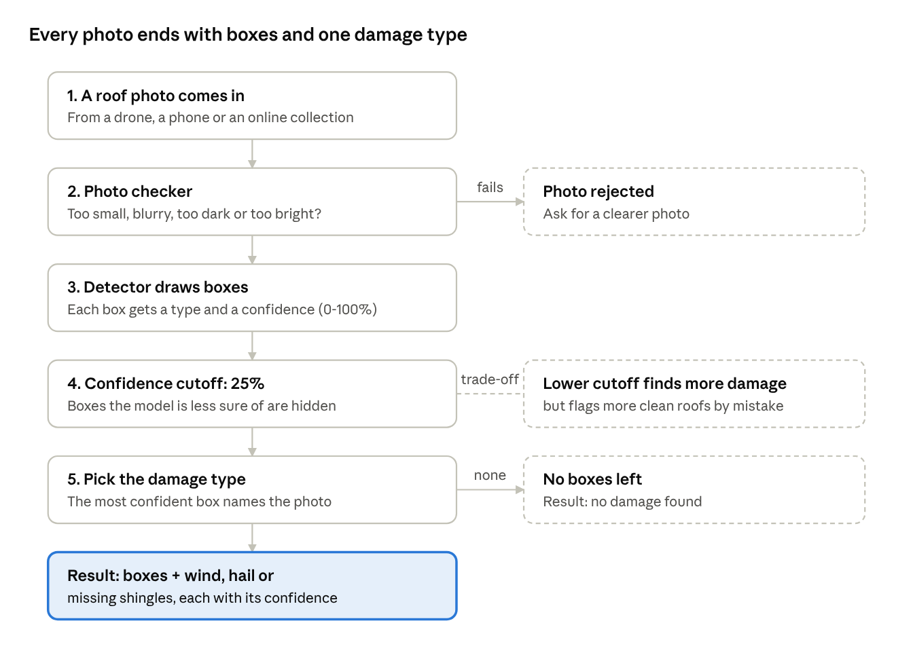
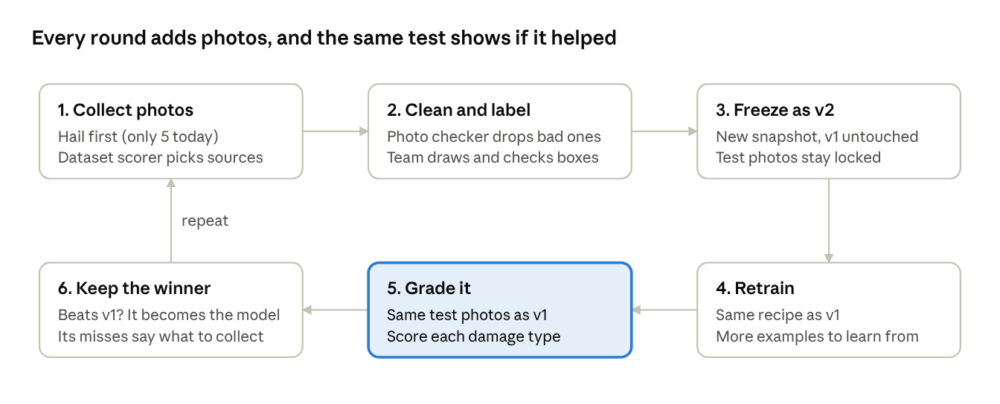

# What the Model Code Merge Means

_As of October 15, 2026_

## The short version

Yesterday we merged all of our model code into the team GitHub repo, the shared online folder where our project's code lives. Anyone on the team can now download it and rebuild the roof damage model from scratch. The code adds 37 files in `Senior-Design-main/ml` plus one tool in `tools/dataset-matrix`. Photos and trained model files stay in the project's shared files, because they're too big for GitHub.

In one sentence: **we saved the full recipe for our model, not just the finished dish, so anyone can repeat it and improve it.**

## What's in the merge

The merge has five parts. Each one does a single job, the way stations in a kitchen do.

| Part | What it does | Think of it as |
| --- | --- | --- |
| Photo checker | Rejects photos that are too small, blurry, too dark or too bright | A bouncer at the door |
| Labels and boxes | Records what each of our 239 photos shows, plus 258 boxes drawn around damage | The answer key |
| Damage detector | Learns from the answer key, then draws boxes and names the damage on new photos | The student |
| Report card | Tests the detector on photos it never saw and scores it | The final exam |
| Dataset scorer | Rates outside photo collections before we download them | A shopping checklist |

The repo also holds a frozen copy of the answer key called **dataset v1**. It locks in the exact labels our first model learned from, so today's scores can always be repeated.

## How the model reads a photo

The model draws a box around each damaged patch, gives every box a confidence score, and lets the most confident box decide the damage type.

The 25% cutoff is a dial we choose, not something the model learns. Turning it down catches more damage but raises more false alarms.

## Where the model stands today

On 29 damaged test photos it had never seen, model v1 named the right damage type 19 times (66%). Wind is its strongest type, and hail doesn't work yet because we only have 5 hail photos in total.

| Damage type | Photos we have | Test photos named correctly |
| --- | --- | --- |
| Wind | 130 | 13 of 17 |
| Missing shingles | 70 | 6 of 10 |
| Hail | 5 | 0 of 2 |

Two other tests point the same way. A model about 3 times larger did no better (17 of 29 correct versus 16 on the practice set). Lowering the confidence cutoff from 25% to 5% found more damage (24 of 29 photos instead of 19) but flagged more clean roofs by mistake. **The fix is more photos, not a bigger model.**

## How the model gets better as the dataset grows

The code we merged turns improvement into a loop we can repeat: add photos, freeze them as a new version, retrain, and grade against the same locked test photos.

Why each step matters:

- **Collect with a target.** Each round's misses tell us what to look for next. Today that's hail, which has 5 photos against 130 for wind.
- **Check before we label.** The photo checker and dataset scorer stop bad or unsuitable photos from wasting labeling time.
- **Freeze every version.** v1 never changes, so we can always prove whether v2 is actually better.
- **Grade on the same test.** If the test photos changed, a higher score could just mean an easier test.
- **Revisit the cutoff.** As the model gets more sure of itself, we can retune the 25% cutoff to catch more damage without extra false alarms.

## Words you'll hear

| Term | Plain meaning |
| --- | --- |
| Repo | The shared online folder that holds our code |
| Merge | Adding a batch of changes into the team's main copy |
| Dataset | Our collection of roof photos and their labels |
| Box | A rectangle drawn around one patch of damage |
| Confidence | How sure the model is about a box, from 0% to 100% |
| Confidence cutoff | The lowest confidence we still show; boxes below it are hidden |
| Training | The model studying labeled photos to learn the patterns |
| Test photos | Photos kept aside so the model is graded on ones it never studied |
| Version (v1, v2) | A frozen snapshot of the dataset, so results can be repeated |
